  

# Hi, I'm Sai Kumar 👋

**Data Analyst & GenAI Engineer** based in Hyderabad, India.

I build ETL pipelines, RAG systems, and Power BI dashboards that turn data into decisions.

## 🛠️ Skills
- **Languages:** Python, SQL, JavaScript, C
- **Data & BI:** Pandas, NumPy, Power BI, Tableau, MySQL, PostgreSQL
- **ML & GenAI:** Scikit-learn, TensorFlow, OpenCV, LangChain, AutoGen
- **Cloud:** AWS (EC2, S3)
- **Web:** React

## 💼 Experience
**Data Analyst, Vangrove Tech** (Oct 2025 – Oct 2026)
- Built Python ETL pipelines for data processing
- Created Power BI and Tableau dashboards for reporting
- Developed a RAG assistant and AutoGen multi-agent auditing system

## 🚀 Projects
- **Hand Gesture Controlling System:** Python, OpenCV, NumPy
- **AI-Based Surveillance System:** Python, OpenCV, TensorFlow

## 🏆 Highlights
- 🥇 1st place, BRAIN-O-VISION AWS Hackathon 2023
- METALOOP 2023, Healthcare track (Unity VR)

## 🎓 Education & Certifications
- B.Tech in Computer Science and Engineering, MLR Institute of Technology (2021–2025)
- Python Programming (Udemy)
- C Programming (HackerRank)
- Integrated AI (Rinex)

## 📫 Let's connect
Open to data analyst and machine learning roles.
